# Dashboards: the chart query language (draft)

Status: **draft for discussion**. Nothing here is built in the portal yet. The grammar, the examples and the images come from a prototype, [dashboards/prototype.py](dashboards/prototype.py), that parses every query below, runs it over **mock data** (about 420 invented findings over 15 months), and draws the PNGs. Run it again after changing the grammar or an example (instructions at the top of the file).

## 1. Idea

One line of text describes one chart. The same line works in a dashboard (on screen or on a TV) and in a report, where it sits in the Markdown as a `chart` block.

```
count by severity where status:sent,fixing,retesting title "Abertas por severidade"
└─┬─┘ └────┬────┘ └───────────────┬────────────────┘ └───────────┬────────────┘
measure  grouping      which findings (Hub filter)            the chart's title
```

The `where` part is **the Hub's filter**, so whoever already filters the Hub knows half the language. The rest says what to count, how to group it and how to draw it.

## 2. Grammar

```ebnf
query    = measure , { clause } ;                 (* each clause at most once, in any order *)

measure  = "count"
         | agg , "days" , date , ".." , date ;    (* time between two dates of the same finding *)
agg      = "avg" | "median" | "min" | "max" | percentile ;
percentile = "p" , digit , digit ;                (* p50, p90, p95 … *)

clause   = by | over | where | top | as | title ;
by       = "by" , dim , [ "," , dim ] ;
over     = "over" , date , "per" , unit ;
where    = "where" , filter ;                     (* the Hub filter, up to the next clause word *)
top      = "top" , integer ;
as       = "as" , chart ;
title    = "title" , quoted-string ;

dim      = "status" | "severity" | "source" | "report" | "operator" ;
date     = "created" | "updated" | "sent" | "accepted" | "fixing" | "retesting" | "fixed" | "risk" ;
unit     = "day" | "week" | "month" | "quarter" | "year" ;
chart    = "number" | "bar" | "hbar" | "line" | "table" ;
```

Clause words (`by`, `over`, `where`, `top`, `as`, `title`) end the clause before them. To search the Hub's free text for one of these words, quote it: `where "by"`.

### Vocabulary

| Part | Meaning |
|---|---|
| `count` | How many findings |
| `median days sent..fixed` | Median of the days between the two dates, over the findings that have both (and the second after the first). Also `avg`, `min`, `max`, `p90`… A value from fewer than **3** findings is shown as "—" |
| `by status` | One bar, row or line per status. Statuses in lifecycle order |
| `by severity` | From the CVSS: critical ≥ 9, high ≥ 7, medium ≥ 4, low > 0, none. Shown critical first |
| `by source`, `by report`, `by operator` | Largest first; "Sem relatório" and "Outros" last |
| `by a, b` | Two groupings: a stacked bar or a cross table. With `over`, only one (it becomes the series) |
| `over fixed per month` | A time axis: each finding falls in the bucket of its `fixed` date. Findings without that date are left out |
| `top 6` | The 6 largest groups of the first `by`; the rest add up to "Outros" |
| `as …` | How to draw it (below). Optional |
| `title "…"` | The title shown above the chart |

### Charts

| `as` | Needs | Default when |
|---|---|---|
| `number` | No `by`, no `over` | Neither `by` nor `over` |
| `bar` | `by` or `over` | `by status` or `by severity`; with `over`, stacked columns |
| `hbar` | `by`, no `over` | `by source`, `by report`, `by operator` (long names) |
| `line` | `over` | `over` |
| `table` | Anything | Never (always chosen) |

Pie charts are left out on purpose: bars compare the same numbers more precisely.

### The time window

With `over`, the window is the period that the `where` filter gives the same date (`over fixed … where fixed:12m`). Without one, the window runs from the first such date in the data until now.

The window **starts on a whole bucket**: `fixed:12m per month` is 12 whole months plus the current one, never a cut-off first month. Buckets without findings show 0 (`count`) or a gap (durations). Weeks start on Monday. All dates are in the portal's time zone.

### Two differences from the Hub filter

1. **`status:a,b` means either.** `status:sent,fixing,retesting` reads as "sent or fixing or retesting". The Hub can't express it today, and charts need it all the time (the open findings). It would be added to the Hub too, so the two stay the same language.
2. **An invalid filter is an error.** While you type, the Hub ignores a token it can't read (`fixed:12w`). A saved chart must not, because it would silently count something else. The prototype found exactly this mistake in one of its own examples.

## 3. Examples

All titles and numbers are from the mock data. "Open" below means `status:sent,fixing,retesting`.

### Numbers

| | |
|---|---|
| `count where status:sent,fixing,retesting title "Abertas"` |  |
| `count where status:sent,fixing,retesting cvss:9 title "Críticas abertas"` |  |
| `count where status:sent -sent:15d title "Aguardando aceite há mais de 15 dias"`. Sent, and not in the last 15 days |  |
| `median days sent..fixed where fixed:90d title "Tempo até a correção (90 dias)"` | 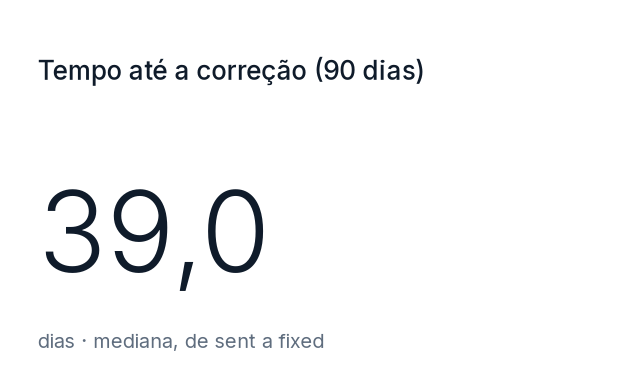 |

### Bars

`count by severity where status:sent,fixing,retesting title "Abertas por severidade"`

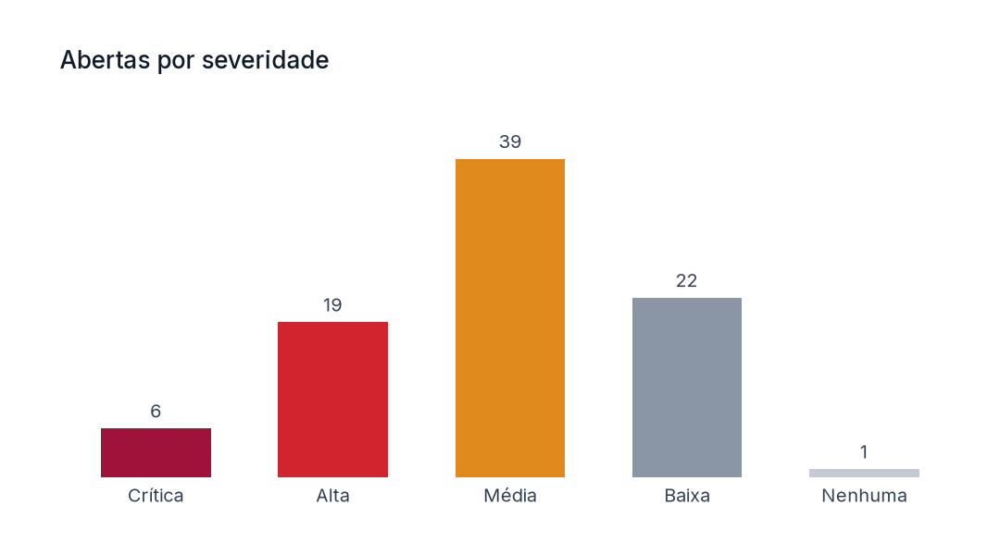

`count by status where -status:draft -status:ready title "Depois do envio"`

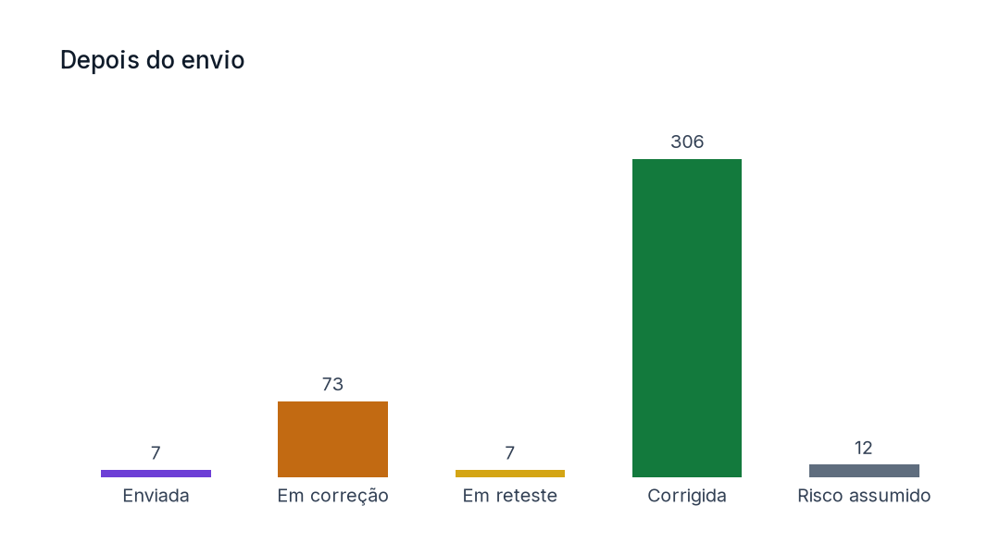

`count by report, severity top 6 where status:sent,fixing,retesting as hbar title "Abertas por relatório"`

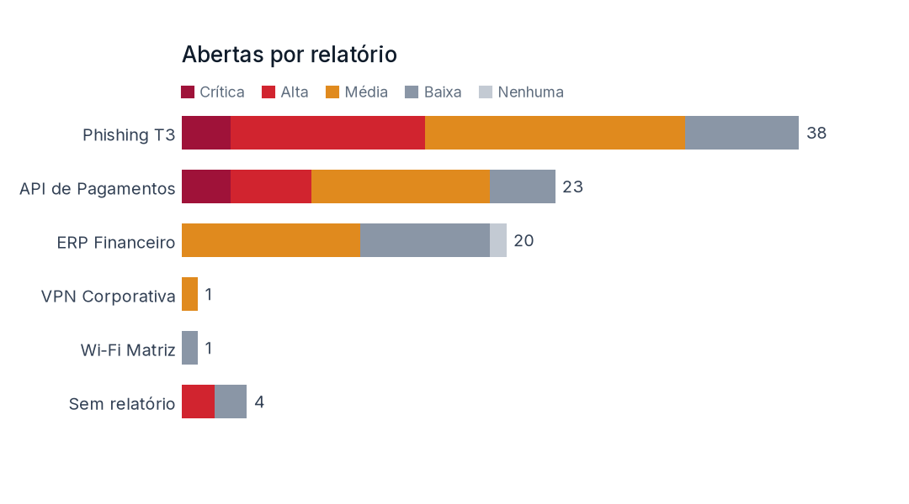

`count by source where created:90d title "Encontradas nos últimos 90 dias, por fonte"`

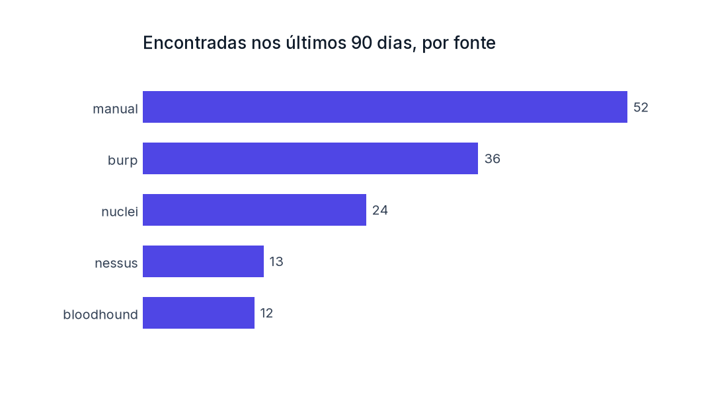

### Over time

`count over sent per month where sent:12m title "Enviadas por mês"`

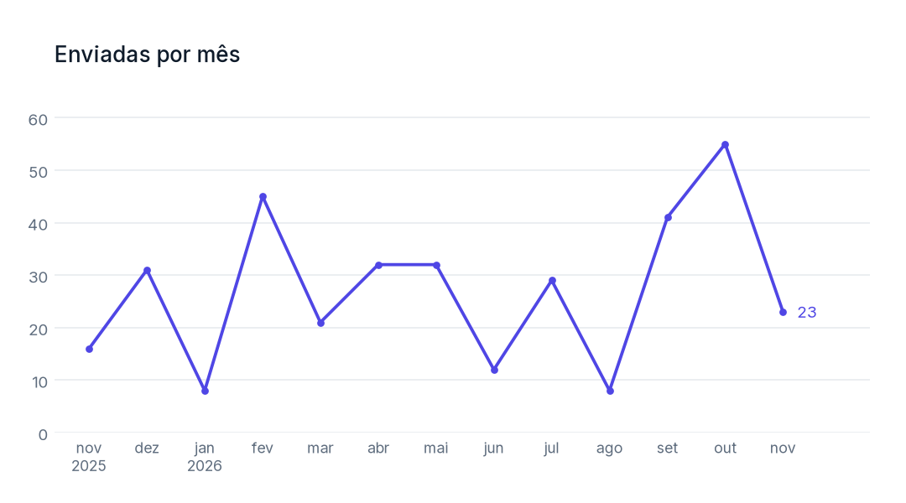

`count by severity over fixed per month where fixed:12m as bar title "Corrigidas por mês"`

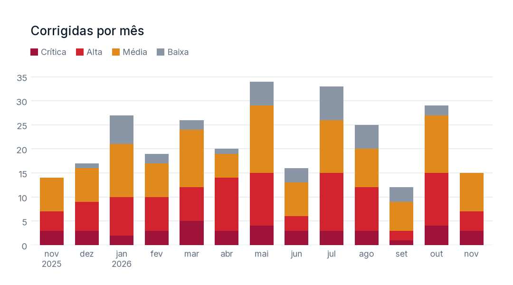

`p90 days sent..accepted by severity over sent per quarter where sent:01-2026.. title "Tempo até o aceite (p90), por trimestre"`. Nine in ten findings sent in each quarter were accepted within this many days. ("Nenhuma" has too few findings, so no line.)

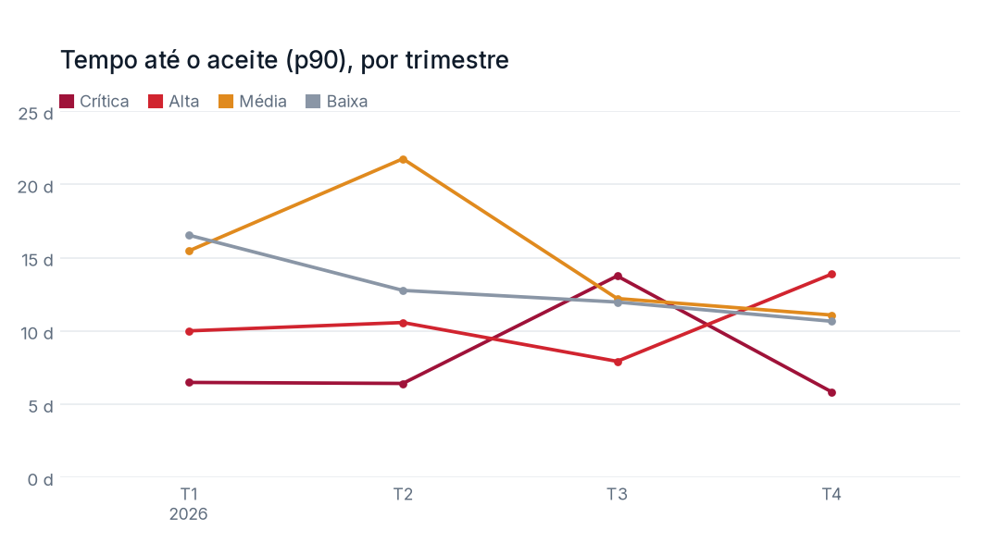

### Tables

`median days sent..fixed by severity where fixed:{period} as table title "Mediana de dias até a correção"`. `{period}` is the dashboard's or the report's period (here August to October 2026). Duration tables also show how many findings each value comes from.

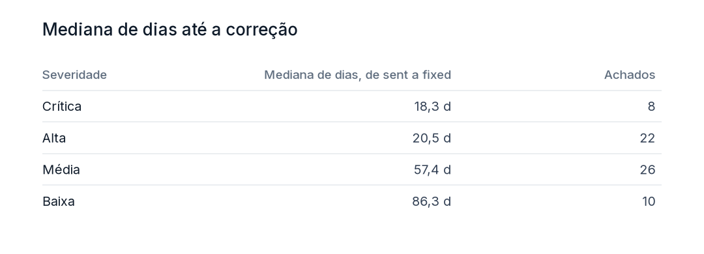

`count by severity, status where -status:draft -status:ready as table title "Severidade × status"`

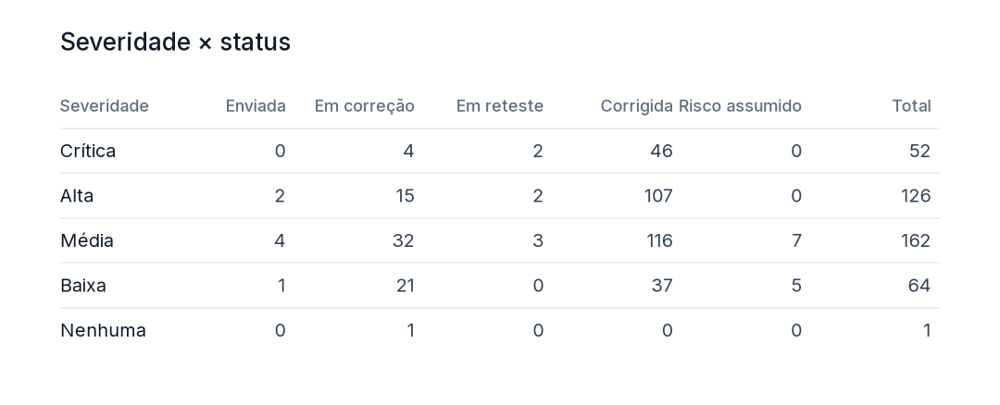

### A TV board

Six queries in a dark, full-screen layout (1920 × 1080). TV links accept only the groupings `status`, `severity` and `source` (section 5), so no report name or person appears.

```
count where status:sent,fixing,retesting title "Abertas"
count where status:sent,fixing,retesting cvss:9 title "Críticas abertas"
count where status:sent -sent:15d title "Aguardando aceite > 15 dias"
count by severity where status:sent,fixing,retesting title "Abertas por severidade"
count by severity over fixed per week where fixed:3m as bar title "Corrigidas por semana"
count by status where status:sent,fixing,retesting title "Em andamento"
```

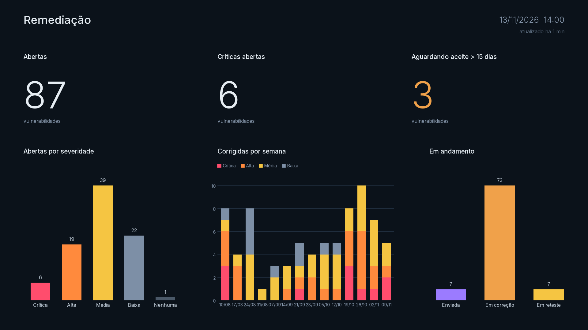

### Errors

Errors give the position and the fix, in the user's language:

| Query | Message |
|---|---|
| `count by host` | não dá para agrupar por "host"; use status, severity, source, report, operator (posição 10) |
| `count where status:sent as pie` | as number\|bar\|hbar\|line\|table (posição 28) |
| `median days sent fixed` | o intervalo é \<data\>..\<data\>, por exemplo sent..fixed (posição 13) |
| `count by report title Abertas` | o título vai entre aspas: title "Abertas" (posição 23) |
| `count over fixed per month as number` | as number mostra um único valor: sem by nem over (posição 1) |
| `count by severity over fixed per week where fixed:12w` | período inválido; use 7d, 3m, 1y ou d1.d2.d3 (dd-mm-aaaa, mm-aaaa, aaaa): "fixed:12w" (posição 45) |
| `count where status:open` | status desconhecido; use draft, ready, sent, fixing, retesting, fixed, risk_accepted: "status:open" (posição 13) |

## 4. In reports

A report is Markdown with `chart` blocks. When the report is generated for a period, `{period}` becomes that period (`01-08-2026..31-10-2026`), and the numbers are **frozen** in the report: editing a finding later does not change a report already issued.

````markdown
## Remediação no trimestre

```chart
count by severity over fixed per week where fixed:{period} as bar title "Corrigidas por semana"
```

```chart
median days sent..fixed by severity where fixed:{period} as table title "Mediana de dias até a correção"
```
````

## 5. Rules (for the real implementation)

- **Computed in the API**, never in the browser, and never turned into SQL text: the query becomes a fixed set of database operations. The results respect the viewer's access rules, so a restricted user's chart counts only what that user may see.
- **Aggregates only.** No query lists findings or shows an identifier, host or description.
- **TV links** (read-only, revocable, recorded in the audit log) accept only `status`, `severity` and `source` groupings, checked when the link is made and again at every refresh. A board computes with the access of the person who made the link.
- **One filter grammar.** The Hub filter now runs in the browser (`frontend/src/filterQuery.js`); the API needs the same rules in Python. A shared file of test cases keeps the two from drifting apart, or a chart and the Hub would count differently.

## 6. Open questions

1. **Who writes queries:** everyone, for their own dashboards, or admins only, with everyone else choosing from shared dashboards?
2. **"Open" as a word.** `status:sent,fixing,retesting` appears in almost every chart. Should `status:open` be a shortcut (in the Hub too)?
3. **Comparisons:** "87 open, 5 more than last week" is a common TV need. A later `vs previous` clause could compare a period with the one before it.
4. **Backlog over time:** "how many were open at the end of each week" is not a count of one date, so the grammar can't say it yet. A later `open … per week` measure could.
5. **Several series from different dates** ("found vs fixed per month") would need two queries in one chart.
6. **SLA targets.** If the organization has remediation deadlines per severity, a `within sla` measure (share fixed on time) would be the most useful chart of all. Does it have them?

The prototype implements sections 2 and 3. Sections 4 and 5 are design only.
